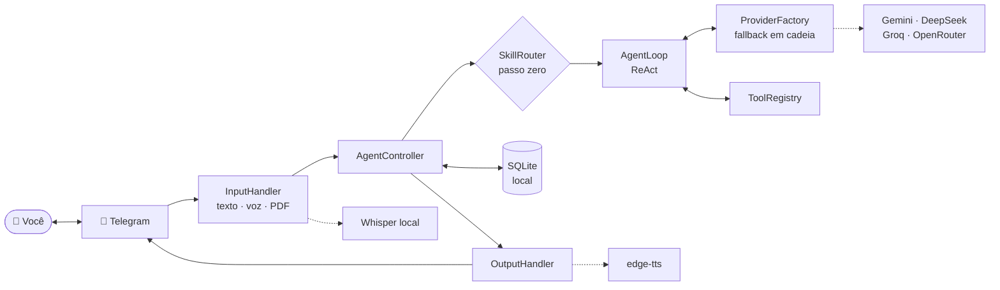

# GeneriClaw

**Agente pessoal de IA que roda na sua máquina e se controla pelo Telegram.**

Texto, voz ou PDF entram pelo chat; o agente raciocina em ciclo ReAct, executa ferramentas no seu filesystem e responde de volta — em texto, arquivo ou áudio. As conversas ficam num SQLite local. Os LLMs são usados **só para inferência**: nenhum histórico sai da sua máquina.



---

## A ideia central: contexto sob demanda

O problema de qualquer agente com muitas habilidades é que a documentação de todas elas compete pela mesma janela de contexto. GeneriClaw resolve isso em **duas etapas**:

1. **Passo zero (roteamento barato).** O `SkillRouter` recebe apenas `nome + descrição` de cada skill — algumas dezenas de tokens — mais a intenção do usuário. Devolve o nome de uma skill, ou `null`.
2. **Injeção em runtime.** Só a skill escolhida tem seu `SKILL.md` completo injetado no system prompt, e só durante aquela requisição. Terminou, o contexto é descartado.

Pergunta solta como *"que horas são?"* devolve `null` no passo zero e cai no agente raiz, sem carregar documentação nenhuma. O custo de ter 50 skills instaladas é o mesmo de ter 3.

> Uma requisição = uma intenção. Encadear múltiplas skills é deliberadamente **não-objetivo**: isso é trabalho do ReAct na etapa seguinte, não do router.

---

## O que está implementado

| Capacidade | Como funciona |
|---|---|
| **Entrada multimodal** | Texto, voz (Whisper local → STT) e PDF (`pdf-parse`) |
| **Saída multimodal** | Texto com chunking, arquivos `.md` e áudio (edge-tts) |
| **Ciclo ReAct** | `AgentLoop` itera pensamento → ferramenta → observação, com teto de iterações |
| **4 provedores de LLM** | Gemini, DeepSeek, Groq e OpenRouter, atrás de uma interface única |
| **Fallback em cadeia** | `FallbackProvider` percorre a lista configurada; cada um com retry e backoff |
| **Memória local** | SQLite (`sql.js`) com janela de contexto deslizante e teto de tamanho |
| **Skills hot-reload** | `agents/skills/` é relido a cada mensagem; criar uma pasta já a disponibiliza |
| **Ferramentas de arquivo** | `criar_arquivo`, `ler_arquivo`, `listar_arquivos`, presas à `WORKSPACE_ROOT` |
| **Histórico de grupos** | Opcional: coletor MTProto lê o passado e o ao vivo dos grupos escolhidos; `historico_grupo` consulta |
| **Especialização de domínio** | Destila glossário, problemas recorrentes e quem-sabe-o-quê dos grupos para `conhecimento/`, com atribuição |
| **Whitelist estrita** | Só IDs em `TELEGRAM_ALLOWED_USER_IDS` são atendidos |
| **Degradação graciosa** | Sem `ffmpeg`/`whisper`/`edge-tts`, o bot sobe e desliga só a voz |
| **Shutdown ordenado** | `SIGINT`/`SIGTERM`, ou `/parar` no chat, param polling e controller, com timeout de 10s |

**Testes:** `npm test` roda 119 testes em 16 arquivos (`vitest`). Vários deles leem o *destino* em vez da origem — o corpo JSON que sai para a API do LLM, o texto que chega na API do Telegram, os arquivos no disco, o stderr de um boot real — porque uma peça que "roda" não é uma peça que entrega.

---

## Arquitetura

Monolito modular com sistema de plugins. A escolha é deliberada: para um agente pessoal rodando num único host, microsserviços só adicionariam latência e cerimônia. O preço é escalar apenas verticalmente — irrelevante para o caso de uso.

```
src/
├── main.ts          # bootstrap: valida config, checa binários, monta o grafo, trata shutdown
├── config.ts        # validação de env com erro explícito (falha rápido, não em runtime)
├── core/            # AgentController (fachada do pipeline) + AgentLoop (motor ReAct)
├── providers/       # Gemini + OpenAiCompat (DeepSeek, Groq, OpenRouter) + factory com fallback
├── memory/          # MemoryManager (janela, truncamento) + repositórios SQLite
├── skills/          # SkillLoader (hot-reload) + SkillRouter (passo zero)
├── tools/           # ToolRegistry + ferramentas de filesystem
├── input/           # Telegram, Whisper, parsing de documentos
└── output/          # chunking, arquivos, edge-tts
```

Cada módulo tem uma spec correspondente em [`specs/`](specs/) com contrato, interface, edge cases e dependências — comece por [`specs/architecture.md`](specs/architecture.md).

---

## Rodando

**Pré-requisitos:** Node 18+, um bot do Telegram ([@BotFather](https://t.me/BotFather)) e ao menos uma API key de LLM.
Opcionais, só para voz: `ffmpeg`, `whisper` e `edge-tts` no `PATH`.

```bash
git clone https://github.com/francojeferson/genericlaw.git
cd genericlaw
npm install
cp .env.example .env    # preencha o token e as chaves
npm run dev
```

O mínimo viável no `.env`:

```env
TELEGRAM_BOT_TOKEN=123456:ABC-DEF...
TELEGRAM_ALLOWED_USER_IDS=seu_id_numerico
LLM_PROVIDER=gemini
GEMINI_API_KEY=AIza...
```

Para usar uma chave só para todos os modelos, preencha `OPENROUTER_API_KEY` e liste os provedores em `LLM_PROVIDERS`. A ordem da lista **é** a ordem de fallback.

Ajustes úteis: `MAX_ITERATIONS` (teto do ReAct), `MEMORY_WINDOW_SIZE` (quantas mensagens entram no contexto), `WORKSPACE_ROOT` (onde as ferramentas podem escrever) e `LOG_MESSAGE_CONTENT=false`, que mantém o conteúdo das mensagens fora dos logs.

---

## Lendo o histórico de grupos (opcional)

O Bot API **não lê histórico**: um bot só recebe o que chega depois de entrar no grupo, e nem existe método para buscar o passado. Quem lê histórico é um cliente MTProto autenticado com uma conta de usuário. Por isso o recurso é separado, opcional e desligado por padrão.

Com ele ligado, um coletor conecta com a sua conta, puxa o histórico dos grupos escolhidos, continua recebendo as mensagens novas ao vivo e grava tudo numa tabela própria (`group_messages`, fora da janela de contexto, para não ser podada). O bot **não responde nos grupos** — eles são fonte de dados. A consulta acontece na DM, pela ferramenta `historico_grupo` (`listar`, `recentes`, `buscar`).

```bash
# 1. api_id e api_hash em https://my.telegram.org -> API development tools
# 2. login por telefone + código; imprime a sessão e lista seus grupos com os ids
npm run telegram:login
# 3. cole TELEGRAM_SESSION e TELEGRAM_GROUP_IDS no .env e reinicie
# depois, para só reler a lista de grupos:
npm run telegram:login -- --listar
```

As quatro variáveis (`TELEGRAM_API_ID`, `TELEGRAM_API_HASH`, `TELEGRAM_SESSION`, `TELEGRAM_GROUP_IDS`) andam juntas: definir uma sem as outras falha no boot de propósito — config pela metade sobe um bot que parece saudável e nunca lê nada. Se o coletor falhar ao subir, o bot continua funcionando normalmente; só o histórico de grupo fica indisponível.

### Especialização no assunto do grupo

Com os grupos sendo coletados, o agente destila o conteúdo em conhecimento durável. A cada boot, se houver pelo menos 30 mensagens novas num grupo, ele roda o LLM sobre o delta e atualiza `<WORKSPACE_ROOT>/conhecimento/<grupo>.md` com três seções: **glossário** (o jargão do grupo), **problemas recorrentes** (sintoma, tentativas, conclusão ou "em aberto") e **quem sabe o quê**. Uma marca d'água por grupo (`group_digest`) guarda até onde já leu, então o custo é proporcional ao que chegou — e uma falha no meio retoma de onde parou em vez de reprocessar tudo.

A destilação roda **sem bloquear o boot**: o bot já atende enquanto ela trabalha, e o conhecimento aparece minutos depois. Se o processo reiniciar no meio, a rodada seguinte continua.

A skill [`conhecimento-grupos`](agents/skills/conhecimento-grupos/SKILL.md) é o que transforma isso em especialização: ela manda o agente ler o destilado antes de responder, usar `historico_grupo` para citar e datar, e **atribuir toda afirmação a quem disse e quando**. Isso não é formalidade — o conteúdo é conversa de terceiros, não verificada e datada. O agente relata o que foi dito; não afirma que é verdade.

Duas coisas ficam deliberadamente de fora do destilado: tese de mercado e recomendação operacional. São a parte mais ruidosa, que envelhece mais rápido e que um agente não deve repetir com voz de autoridade. Continuam no histórico cru, acessíveis com atribuição.

**O destilado erra.** É um resumo gerado por LLM de conversa fragmentada — o glossário pode definir por dedução um termo que o grupo nunca explicou. O prompt exige marcar termo não explicitado em vez de inferir, mas a garantia não é absoluta. Trate como índice do que o grupo discutiu, não como fonte de verdade; para o que importa, o histórico cru é a fonte.

**Antes de ligar, entenda o custo:** `TELEGRAM_SESSION` equivale a estar logado na sua conta — trate como senha. Automatizar uma conta de usuário ("userbot") é zona cinzenta no ToS do Telegram, e o risco de limitação ou ban recai na sua conta pessoal, não no bot. E o conteúdo dos grupos fica em texto claro no SQLite, incluindo mensagens de terceiros que não escolheram ser arquivadas.

---

## Criando uma skill

Uma skill é uma pasta com um `SKILL.md`. Não há build, registro nem restart:

```
agents/skills/
└── revisor-de-contrato/
    └── SKILL.md
```

```markdown
---
name: revisor-de-contrato
description: Revisa cláusulas de contrato e aponta risco jurídico
version: 1.0.0
requires: [ler_arquivo, criar_arquivo]
---

Você é um revisor de contratos. Para cada cláusula recebida:
1. Classifique o risco como baixo, médio ou alto.
2. Cite a cláusula exata que gerou a classificação.
3. Proponha uma redação alternativa quando o risco for alto.

Entregue o resultado como arquivo .md.
```

O `description` é o que o router vê no passo zero — é ele que decide se a skill é acionada, então escreva pensando em **quando** ela deve disparar. O corpo é o system prompt completo, injetado só quando ela ganha.

---

## Privacidade

A whitelist por ID de usuário do Telegram é verificada antes de qualquer processamento. O banco, os arquivos gerados e os temporários ficam no host. Para as APIs de LLM vai apenas o contexto necessário à inferência — e `LOG_MESSAGE_CONTENT=false` evita que o conteúdo apareça nos logs locais.

Com Whisper rodando localmente, **áudio nunca sai da máquina**.
