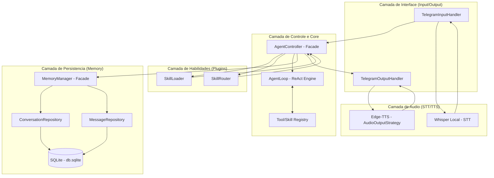
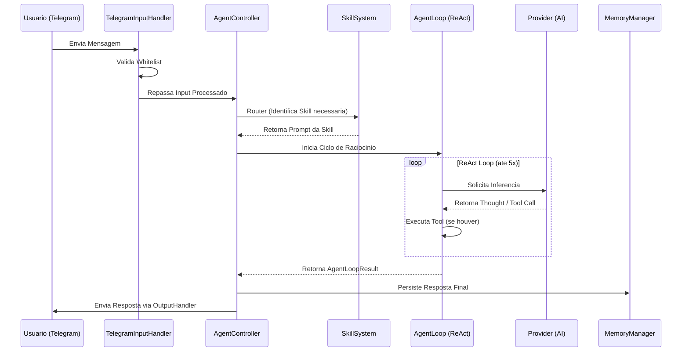

# Arquitetura do Projeto: GeneriClaw

---

## 1. Visao Geral

O **GeneriClaw** e um agente pessoal de Inteligencia Artificial projetado para operar localmente no desktop do usuario. Sua interface primaria de controle e o Telegram, permitindo uma interacao fluida via texto, documentos e voz. O sistema e construido para ser modular, extensivel atraves de "skills" (habilidades) e totalmente focado na privacidade, mantendo a persistencia de dados localmente.

A arquitetura segue um fluxo de pipeline onde as mensagens do Telegram sao capturadas, processadas por um motor de raciocinio (Agent Loop) que utiliza LLMs externos (como Gemini ou DeepSeek) apenas para inferencia, e responde de volta ao usuario de forma inteligente, podendo inclusive gerar arquivos ou respostas em audio.

---

## 2. Requisitos Arquiteturais

| Requisito | Tipo | Prioridade | Notas |
|-----------|------|------------|-------|
| Operacao Local | Nao-funcional | Critica | O "core" deve rodar no host local (Windows). |
| Interface Telegram | Funcional | Alta | Uso da biblioteca `grammy` para polling. |
| Persistencia Local | Funcional | Alta | Armazenamento de conversas em SQLite. |
| Padronizacao de LLMs | Nao-funcional | Alta | Troca dinamica de provedores (Gemini, DeepSeek, Groq). |
| Multimodalidade (Input) | Funcional | Media | Suporte a PDF e Voz (STT via Whisper Local). |
| Multimodalidade (Output)| Funcional | Media | Suporte a Arquivos (.md) e Voz (TTS). |
| Seguranca de Acesso | Funcional | Critica | Whitelist estrita baseada em ID de usuario do Telegram. |

---

## 3. Estilo Arquitetural

O sistema adota um estilo **Monolito Modular com Sistema de Plugins**.  
- **Monolito Modular:** Facilita o desenvolvimento e deploy local sem a complexidade de microsservicos.
- **Plugin-based (Skills):** Permite que novas funcionalidades sejam adicionadas ou atualizadas via "Hot-Reload" apenas manipulando diretorios na pasta `agents/skills`, sem reiniciar o processo principal.

**Trade-offs:**  
- **Vantagem:** Baixa latencia interna, facilidade de manutencao para um unico desenvolvedor, alta coesao.
- **Desvantagem:** Escalabilidade vertical limitada ao hardware do host local (nao e um problema para o caso de uso de agente pessoal).

---

## 4. Diagrama de Contexto

```mermaid
graph TB
    User([ Usuario Generic])
    Telegram[ Telegram Client]
    System[\ufe0f GeneriClaw Engine]
    LLM[ LLM APIs - Gemini/DeepSeek]
    Whisper[\ufe0f Whisper Local - STT]
    EdgeTTS[ Edge-TTS - TTS]

    User <-->|Envia Msg/Voz/Doc| Telegram
    Telegram <-->|Polling/Reply| System
    System <-->|Prompt/Response| LLM
    System -->|Processa Audio| Whisper
    System -->|Gera Audio| EdgeTTS
```

---

## 5. Diagrama de Componentes e Camadas

O projeto segue estritamente a **Programacao Orientada a Objetos (POO)** com separacao clara de responsabilidades em arquivos e modulos distintos.



---

## 6. Decisoes de Tecnologia (Source of Truth)

Este topico centraliza as definicoes de stack. **Alteracoes aqui devem refletir mudancas em toda a arquitetura do sistema.**

| Componente | Tecnologia | Detalhes / Justificativa |
|------------|------------|-------------------------|
| **Linguagem** | **Node.js (TypeScript)** | Ambiente ratido para IO, ecossistema rico e familiaridade. |
| **Paradigma** | **Orientacao a Objetos** | Uso obrigatorio de Classes, Interfaces e Padroes de Projeto (User Rule). |
| **Banco de Dados**| **SQLite** | Local, serverless, sem dependencia nativa (`sql.js`, wasm). |
| **Interface Bot** | **grammy** | Framework moderno e performatico para Telegram Bot API. |
| **Raciocinio IA** | **ReAct Pattern** | Loop de "Thought -> Action -> Observation -> Answer". |
| **STT (Voz)** | **Whisper (Local)** | Transcricao privada sem custo de API. Binario `whisper` CLI invocado via `child_process.execFile`. Modelos multi-GB rodam em processo separado para nao bloquear o event loop do Node. |
| **Conversao Audio** | **ffmpeg (Obrigatorio)** | Converte OGG/OPUS do Telegram para WAV mono 16kHz antes do Whisper. Verificado na inicializacao. Se ausente, entrada de voz e desabilitada. |
| **TTS (Fala)** | **Edge-TTS** | Geracao de voz de alta qualidade (`pt-BR-Thalita`). |
| **Parser Documentos**| **pdf-parse** | Extracao de texto de PDFs para processamento pela IA. |
| **Testes** | **vitest** | Unica dependencia de teste. Mock de rede via `vi.stubGlobal("fetch", ...)`. |

**Dependencias de producao, na integra:** `grammy`, `sql.js`, `pdf-parse`, `dotenv`. Mais nada.
Identificadores unicos usam `crypto.randomUUID()` do proprio Node - o pacote `uuid` foi removido por
ser duas chamadas que a plataforma ja oferece.

### Ciclo de Vida do Modelo Whisper

Modelos Whisper sao arquivos multi-GB (`ggml-*.bin`) armazenados em `./models/whisper/`. 

**Download inicial:** O modelo NAO e baixado automaticamente. O usuario deve executar um script de setup (ex: `npm run setup:whisper`) que baixa o modelo `ggml-small.bin` (ou o configurado em `WHISPER_MODEL`) para `./models/whisper/`. O download e unico e o arquivo persiste entre reinicializacoes.

**Tamanhos por modelo:**
| Modelo | Tamanho aprox. | RAM necessaria |
|--------|---------------|----------------|
| tiny | ~75 MB | ~1 GB |
| base | ~150 MB | ~1 GB |
| small | ~500 MB | ~2 GB |
| medium | ~1.5 GB | ~5 GB |
| large | ~3 GB | ~10 GB |

**Validacao na inicializacao:** O `WhisperProcessor.isAvailable()` verifica se o binario `whisper` (configurado em `WHISPER_BINARY`) existe no PATH e se o arquivo de modelo existe em `./models/whisper/`. Se o binario nao for encontrado, entrada de voz e desabilitada. Se o binario existir mas o modelo nao, o sistema loga warning: `[WhisperProcessor] Model file not found at ./models/whisper/ggml-small.bin. Run npm run setup:whisper to download.` e entrada de voz e desabilitada ate que o modelo seja instalado.

**Modelo corrompido:** Se o arquivo do modelo existir mas estiver truncado ou corrompido (hash SHA256 nao confere), o Whisper CLI falha na primeira transcricao. O `WhisperProcessor.transcribe()` captura o erro e notifica: "Modelo Whisper corrompido. Execute npm run setup:whisper novamente."

**Diretorio de modelos:** `./models/` e gitignored. Modelos sao compartilhados entre instalacoes do GeneriClaw na mesma maquina se o usuario criar um symlink para um diretorio central de modelos.

**Tempo de processamento vs timeout:** O tempo de transcricao escala com o tamanho do modelo e a duracao do audio. Estimativas para CPU moderna (sem GPU):
- small model: ~2x tempo real (audio de 30s processa em ~60s)
- medium model: ~4x tempo real (audio de 30s processa em ~120s)
- large model: ~8x tempo real (audio de 15s processa em ~120s)

O timeout de 60s definido em telegram-input.md EC-02 e suficiente para audios de ate ~30s com o modelo small. Usuarios de modelos medium/large ou audios longos devem esperar timeouts. Para mitigar: usar o modelo small (recomendado para MVP) ou aumentar `WHISPER_TIMEOUT_MS` no `.env`.

---

## 7. Design Patterns Utilizados

Para manter a alta coesao e baixo acoplamento, os seguintes padroes sao aplicados:

1.  **Facade:** Utilizado no `AgentController` e `MemoryManager` para simplificar a interface com subsistemas complexos.
2.  **Factory:** `ProviderFactory` para instanciar diferentes provedores de LLM. As ferramentas sao resolvidas diretamente pelo `ToolRegistry.get()`, sem fabrica separada.
3.  **Repository:** Para abstrair o acesso ao banco de dados SQLite (`ConversationRepository`, `MessageRepository`).
4.  **Singleton:** Garantir instancia unica da conexao com o banco de dados.
5.  **Strategy:** No `TelegramOutputHandler` para decidir entre enviar texto puro, chunks ou arquivos.
6.  **Registry:** No sistema de Skills e Tools para registro dinamico de capacidades.
7.  **Observer (EventEmitter):** No fluxo `userBlocked` entre `TelegramOutputHandler` e `AgentController`. O OutputHandler emite o evento quando detecta erro 403 "Forbidden" (usuario bloqueou o bot), e o AgentController escuta para chamar `MemoryManager.markConversationBlocked()`. Ver telegram-output.md EC-03 e agent-controller.md 6.2 step 14.

---

## 8. Fluxos Criticos (Sequence Diagram)

### Fluxo de Processamento de Mensagem


---

## 9. Infraestrutura e Deploy

- **Ambiente:** Execucao direta no Windows via Terminal.
- **Process Management:** `npm run dev` (utilizando nodemon para hot-reload do core).
- **Diretorios de Dados:**
    - `./data/`: Banco de dados SQLite (`.db`).
    - `./tmp/`: Arquivos temporarios (PDFs/Audios) deletados apos uso.
    - `agents/skills/`: Plugins de habilidades em Markdown.

---

## 10. Logging e Observabilidade

**Niveis de log:**
| Nivel | Uso | Exemplo |
|-------|-----|---------|
| ERROR | Falhas que interrompem o pipeline (provider offline, DB corrompido). | `[AgentLoop] Provider failed: ECONNREFUSED` |
| WARN | Degradacoes nao criticas (tool nao encontrada, skill sem frontmatter, rate limit). | `[SkillLoader] Skill 'xyz' has no YAML frontmatter, skipping` |
| INFO | Transicoes de etapa no pipeline (inicio/fim de handle, skill selecionada, iteracao concluida). | `[AgentController] input -> skill -> agent -> memory -> output` |
| DEBUG | Conteudo de mensagens, tool arguments, respostas do LLM. | `[AgentLoop] Tool call: criar_arquivo { path: "output/prd.md" }` |

**Formato:** `[Modulo] Mensagem`. Sem timestamp explicito - o terminal adiciona via configuracao do runtime.

**Destino:** `stdout` (console). Sem arquivo de log no MVP.

**Flag de controle:** `LOG_MESSAGE_CONTENT=false` (padrao). Quando `true`, mensagens de nivel DEBUG sao liberadas. O padrao e `false` para evitar expor conteudo de conversas em logs visiveis em producao. Desenvolvedores devem optar ativamente por `true` quando precisarem de logs detalhados.


## 11. Riscos e Mitigacoes

| Risco | Impacto | Mitigacao |
|-------|---------|-----------|
| Corrupcao do SQLite | Alto | Uso de WAL (Write-Ahead Logging) e backups locais periodicos. |
| Falha na API de LLM | Alto | Implementacao de `fallback` no `ProviderFactory`. |
| Vazamento de Memoria (Node) | Medio | Gerenciamento estrito de Buffer de audio e exclusao de arquivos TMP. |
| Estouro de Contexto IA | Medio | Truncamento nativo no `MemoryManager` via `MEMORY_WINDOW_SIZE`. |

---

## 12. Estrutura de Diretorios

```
genericlaw/
  src/
    main.ts         # bootstrap: valida config e providers, monta o grafo, trata shutdown
    config.ts       # AppConfig, validateConfig, ConfigError (sem singleton global)
    core/           # AgentController, AgentLoop
    input/          # TelegramInputHandler, WhisperProcessor
    output/         # TelegramOutputHandler, OutputStrategies, EdgeTTSProcessor
    memory/         # MemoryManager, SqliteConversationRepository, SqliteMessageRepository
    providers/      # ILlmProvider, ProviderFactory, GeminiProvider, OpenAiCompatProvider
    skills/         # SkillLoader, SkillRouter
    tools/          # ITool, ToolRegistry, BaseTool, helpers de path, implementacoes
    scripts/        # setup-whisper.ts (baixa binario e modelo)
  agents/
    skills/         # Plugins de habilidades (.md, relidos a cada mensagem)
  data/             # SQLite .db (gitignored)
  output/           # WORKSPACE_ROOT: arquivos criados pelo agente (gitignored)
  tmp/              # Arquivos temporarios (pdf, audio) - esvaziados no finally de cada handler
  tests/            # suite plana, um arquivo por comportamento (ver PRD.md 13)
  specs/            # Documentacao de especificacao
```

**Estrategia de Testes:** definida em `PRD.md` secao 13. A suite e **plana** - sem
`unit/`/`integration/`/`mocks/`. Cada arquivo cobre um comportamento e carrega seus proprios dublês
locais (`ScriptedProvider`, `FakeContext`, `FakeTts`, `fakeBot`), porque um diretorio de mocks
compartilhados acopla testes que deveriam poder divergir. A regra que orienta todos eles: **o teste
le o destino**, nao o objeto que a funcao devolve.

---

## Gaps de Documentacao (Observacoes)

Os seguintes elementos foram inferidos ou precisam de definicao futura conforme o amadurecimento do codigo:

| Elemento | Status | Recomendacao |
|----------|--------|--------------|
| Migrations de BD | Documentado | memory.md Secao 9 define estrategia MVP: recriar se schema invalido. Migracoes incrementais na versao 2. |
| Rate Limiting Telegram | Confirmado | telegram-output.md EC-01 define retry com `Retry-After` header e sleep no OutputHandler ao receber erro 429. |
| Versao do Node.js | Inferido | Recomenda-se LTS (v20+) para estabilidade das bibliotecas nativas de FS. |
